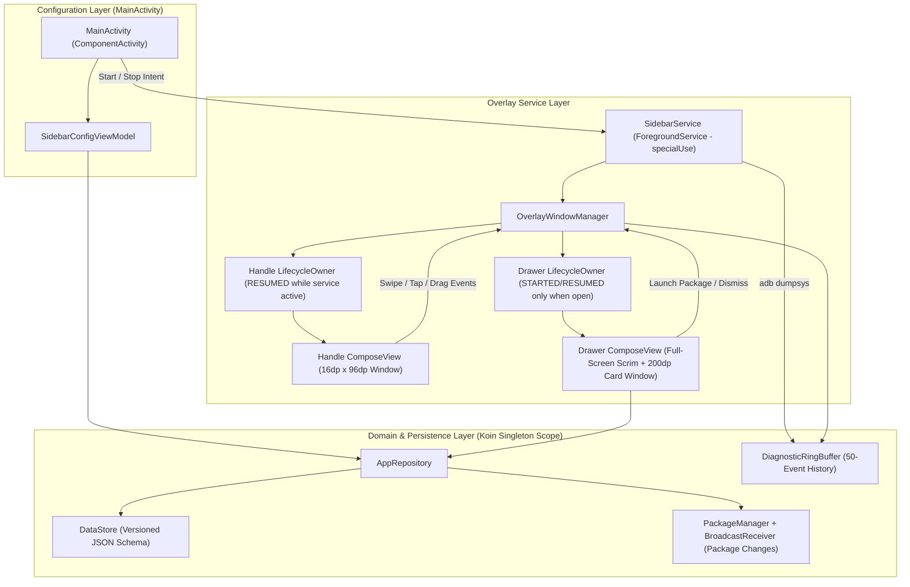

# SideBar Personal Utility Overlay

*   **Author:** Tushar ahmed
*   **Status:** Draft
*   **Date:** 2026-11-06

--------------------------------------------------------------------------------

## Overview

SideBar is a personal, sideloaded Android application (targeting API 29–37, with primary validation on API 30–35) that provides an edge-anchored overlay handle for launching user-pinned applications from any screen. The application runs a persistent Foreground Service (`specialUse` subtype on API 34+) that manages two distinct `WindowManager` overlay windows: a compact, non-focusable edge handle and a transient modal drawer rendered with Jetpack Compose.

## The Problem

Switching between frequently used applications on Android requires navigating back to the home screen or opening the system recents overview, interrupting the current foreground activity. Existing third-party edge launchers either consume excessive memory by maintaining a full-screen invisible overlay window at all times, collide with Android's system edge-back gesture navigation, or fail to launch activities reliably under Android 14+ Background Activity Launch (BAL) restrictions.

SideBar solves this by separating the idle edge trigger from the expanded drawer window, scoping system gesture exclusions strictly to the 96dp handle height, and deactivating UI state collection whenever the drawer is closed.

## Goals

*   **Dual-Window Overlay Isolation**: Maintain a persistent handle window (16dp width × 96dp height, `FLAG_NOT_FOCUSABLE`) while collapsed, attaching a secondary modal drawer window only during active expansion so background applications receive unimpeded touch events.
*   **Gesture Exclusion Compliance**: Register a 96dp `SystemGestureExclusionRect` on the handle view to prevent conflicts with the Android system back gesture while staying within the 200dp per-edge system limit.
*   **Zero Idle Recomposition Overhead**: Stop all Jetpack Compose `StateFlow` collectors and animations when the drawer is collapsed using `SharingStarted.WhileSubscribed(5000)`.
*   **Deterministic App Launching**: Launch user-pinned applications via `Intent.FLAG_ACTIVITY_NEW_TASK` and collapse the drawer immediately upon dispatch.
*   **Persistent Configuration**: Store the ordered list of pinned package names and the vertical handle offset in AndroidX DataStore Preferences using a versioned JSON schema.
*   **On-Device Operational Diagnostics**: Implement `Service.dump()` to expose window parameters, lifecycle states, gesture exclusion bounds, and a 50-event ring buffer over `adb shell dumpsys activity service`.

## Non-Goals

*   **Google Play Store Distribution**: The application targets personal sideloading. It uses `QUERY_ALL_PACKAGES` and `SYSTEM_ALERT_WINDOW` without implementing Play Store policy workarounds.
*   **Hardware System Toggles**: Direct hardware controls (such as camera flashlight toggles or system brightness sliders) are excluded from the initial version to avoid camera lock contention (`CameraAccessException`) and extra runtime permissions.
*   **Multi-Window / Freeform App Hosting**: SideBar launches standard full-screen activities; it does not host third-party apps inside floating mini-windows.

## Open Questions

*   None currently open. All initial architectural questions regarding distribution target, gesture disambiguation, orientation handling, and tool scope were resolved during brainstorming.

## Critical User Journeys (CUJs)

### CUJ 1: First-Time Permission Onboarding and Service Activation

*   **Given**: The user installs and launches SideBar for the first time, and `Settings.canDrawOverlays(context)` returns `false`.
*   **When**: The user taps the "Grant Overlay Permission" button in `MainActivity`, enables "Display over other apps" for SideBar in system settings, returns to `MainActivity`, and toggles the "Enable SideBar Service" switch to ON.
*   **Then**: `SidebarService` starts as a `specialUse` foreground service, posts its ongoing notification, reads the default vertical offset from DataStore, and attaches the 16dp × 96dp handle window to the right screen edge.

### CUJ 2: Selecting and Ordering Pinned Applications

*   **Given**: `MainActivity` is open and the overlay permission is granted.
*   **When**: The user checks three installed applications in the app picker list and closes `MainActivity`.
*   **Then**: `AppRepository` serializes the ordered list of selected package names with `schema_version = 1` into DataStore Preferences, and the in-memory `StateFlow` updates with the resolved labels and icons.

### CUJ 3: Repositioning the Edge Handle Vertically

*   **Given**: The `SidebarService` is running and the 96dp handle is visible on the right screen edge.
*   **When**: The user drags the handle vertically along the Y-axis and releases their finger.
*   **Then**: `OverlayWindowManager` updates `WindowManager.LayoutParams.y` on each drag frame, clamps the coordinate within the visible display bounds, updates the 96dp gesture exclusion rect on release, and persists the final Y coordinate to DataStore.

### CUJ 4: Expanding the Drawer and Launching a Pinned Application

*   **Given**: The user is inside any third-party foreground application with the SideBar handle collapsed on the edge.
*   **When**: The user swipes inward (>24dp displacement) or taps the handle, then taps a pinned application icon inside the revealed drawer.
*   **Then**: `OverlayWindowManager` attaches the modal drawer window with a slide-in transition; upon icon tap, `SidebarService` fires the package launch intent with `FLAG_ACTIVITY_NEW_TASK` and immediately removes the drawer window, returning the overlay to the handle-only state.

## Technical Plan (Architecture)

### System Architecture Diagram



### 1. Component Boundaries and Responsibilities

The system is partitioned into four decoupled layers wired through a single Koin module (`sidebarModule`):

1.  **`AppRepository` (Domain & Data Layer)**:
    *   Queries launchable activities via `PackageManager.queryIntentActivities(Intent(Intent.ACTION_MAIN).addCategory(Intent.CATEGORY_LAUNCHER), 0)`.
    *   Maintains an in-memory cache of resolved `AppShortcut` items (package name, label, icon `Drawable`, pinned status, and sort index) so drawer expansion never blocks on disk or `PackageManager` IPC.
    *   Registers a `BroadcastReceiver` for `ACTION_PACKAGE_ADDED`, `ACTION_PACKAGE_REMOVED`, and `ACTION_PACKAGE_REPLACED` to prune uninstalled packages and refresh cached metadata automatically.
    *   Reads and writes user configuration to Jetpack DataStore Preferences using a versioned JSON payload.
2.  **`OverlayLifecycleOwner` (Synthetic Compose Environment)**:
    *   Implements `LifecycleOwner`, `SavedStateRegistryOwner`, and `ViewModelStoreOwner` so `ComposeView` can operate outside an Activity context.
    *   Provides `attachToView(view: ComposeView)` and deterministic state transition methods (`moveToState(Lifecycle.State)` and `destroy()`), ensuring `Recomposer` coroutines and `ViewModelStore` instances are cleaned up when a window is removed.
3.  **`OverlayWindowManager` (Dual-Window Controller)**:
    *   Encapsulates all `WindowManager` interactions, layout parameter mutations, touch coordinate clamping, and gesture exclusion rect updates.
    *   Manages two distinct windows:
        *   **Handle Window (`handleView`)**: Attached for the lifetime of the service. Uses `TYPE_APPLICATION_OVERLAY`, `FLAG_NOT_FOCUSABLE or FLAG_LAYOUT_NO_LIMITS`, `PixelFormat.TRANSLUCENT`, `Gravity.TOP or Gravity.END`, width `16.dp`, height `96.dp`.
        *   **Drawer Window (`drawerView`)**: Attached to `WindowManager` only when transitioning to the `EXPANDED` state and removed immediately upon collapse. Uses `TYPE_APPLICATION_OVERLAY`, `FLAG_NOT_TOUCH_MODAL or FLAG_WATCH_OUTSIDE_TOUCH`, `PixelFormat.TRANSLUCENT`, `Gravity.FILL`, width `MATCH_PARENT`, height `MATCH_PARENT` (hosting a full-screen transparent touch-dismissal scrim and a right-aligned `200.dp` card container).
4.  **`SidebarService` (Foreground Service Container)**:
    *   Runs with `foregroundServiceType="specialUse"` and declares the mandatory `android.app.PROPERTY_SPECIAL_USE_FGS_SUBTYPE` property in `AndroidManifest.xml`.
    *   Executes a startup crash-loop check against historical restart timestamps stored in DataStore and `ActivityManager.getHistoricalProcessExitReasons()`. If more than 5 restarts occur within 60 seconds, it halts window attachment and posts an error notification.
    *   Forwards `onConfigurationChanged(newConfig)` events to `OverlayWindowManager` so handle vertical coordinates are proportionally clamped on screen rotation.
    *   Implements `dump(fd, writer, args)` to print diagnostic state over ADB.

### 2. Data Structures and Persistence Schema

```kotlin
data class AppShortcut(
    val packageName: String,
    val label: String,
    val icon: Drawable?,
    val isPinned: Boolean,
    val orderIndex: Int
)

// Serialized as JSON under stringPreferencesKey("sidebar_config_json")
data class PersistedSidebarConfig(
    val schemaVersion: Int = 1,
    val pinnedPackages: List<String> = emptyList(),
    val handleYOffsetPx: Int = 300,
    val recentStartTimestampsEpochMs: List<Long> = emptyList()
)
```

Using a single JSON-encoded preference entry with `schemaVersion = 1` preserves the exact user-selected ordering of pinned apps (which `stringSetPreferencesKey` cannot guarantee) and allows atomic reads and updates.

### 3. Gesture Disambiguation and System Exclusion Mechanics

*   **System Gesture Exclusion Quota**: Whenever the handle view lays out (`Modifier.onGloballyPositioned`) or finishes a vertical drag (`onDragEnd`), `OverlayWindowManager` calls `ViewCompat.setSystemGestureExclusionRects(handleView, listOf(Rect(0, 0, widthPx, heightPx)))`. Because the handle height is fixed at `96.dp`, it stays under Android's `200.dp` per-edge ceiling.
*   **Touch Arbitration in `SidebarHandle`**:
    *   **Tap**: Single tap immediately triggers `OverlayWindowManager.openDrawer()`.
    *   **Horizontal Drag (`detectHorizontalDragGestures`)**: Accumulates inward horizontal displacement ($\Delta x < 0$ from the right edge). Once $|\Delta x| > 24\text{dp}$ or velocity exceeds $500\text{dp/s}$, the gesture triggers `openDrawer()`.
    *   **Vertical Drag (`detectVerticalDragGestures`)**: Updates `handleLayoutParams.y` in memory and calls `windowManager.updateViewLayout(handleView, handleLayoutParams)` clamped to $[0, \text{screenHeightPx} - \text{handleHeightPx}]$. Exclusion rects and DataStore persistence are updated only on `onDragEnd` or `onDragCancel` to avoid flooding `IWindowSession` IPC on every frame.

### 4. Lifecycle Gating and Background Activity Launch (BAL) Contract

*   **Drawer Lifecycle Gating**: While the drawer is closed, `drawerView` is detached from `WindowManager` and its `OverlayLifecycleOwner` is held at `Lifecycle.State.CREATED` (or destroyed). Pinned app flows use `stateIn(serviceScope, SharingStarted.WhileSubscribed(5000), emptyList())`, ensuring zero active Compose collectors after 5 seconds of drawer inactivity.
*   **App Launch Flow**: When a user taps an `AppShortcut` inside `SidebarDrawer`:
    1.  `OverlayWindowManager.closeDrawer()` is invoked first to detach the modal overlay window.
    2.  `PackageManager.getLaunchIntentForPackage(packageName)` is resolved with `Intent.FLAG_ACTIVITY_NEW_TASK or Intent.FLAG_ACTIVITY_RESET_TASK_IF_NEEDED`.
    3.  `context.startActivity(intent)` is executed inside a `runCatching` block. Every launch attempt and result (`SUCCESS`, `ACTIVITY_NOT_FOUND`, `SECURITY_EXCEPTION`) is recorded in `DiagnosticRingBuffer`.

## Alternatives Considered

### Alternative A: Single Full-Screen Compose Overlay Window

*   **Pros**: Simplifies window management by keeping a single `ComposeView` attached to `WindowManager` at all times and animating both the edge handle and drawer inside one shared coordinate space.
*   **Cons**: Maintaining an idle full-screen window with `FLAG_NOT_TOUCH_MODAL` intercepts or desynchronizes touch dispatch to underlying applications. Alternatively, dynamically resizing a single window from `16dp × 96dp` to `MATCH_PARENT × MATCH_PARENT` on every swipe forces expensive `SurfaceFlinger` buffer reallocations and causes visible frame drops during the opening animation.
*   **Reason for Rejection**: Rejected by author: Dual-window segmentation isolates the persistent `16dp × 96dp` non-focusable handle window from the transient full-screen modal drawer window, eliminating background touch interference without dynamic buffer resizing.

### Alternative B: Pure Native Android `View` Hierarchy for Overlay Windows

*   **Pros**: Avoids initializing a custom `LifecycleOwner`, `SavedStateRegistryOwner`, `ViewModelStoreOwner`, and Compose `Recomposer` inside a background service, reducing base memory footprint.
*   **Cons**: Requires maintaining separate UI toolkits (XML/Canvas Views for the service overlay vs. Jetpack Compose for `MainActivity`), duplicating theme definitions, icon rendering logic, and animation code.
*   **Reason for Rejection**: Rejected by author: Using Jetpack Compose across both `MainActivity` and the `WindowManager` views unifies the UI layer under Material 3, while detaching the drawer window and using `SharingStarted.WhileSubscribed(5000)` eliminates idle recomposition overhead when the drawer is closed.

### Alternative C: Storing Pinned Packages in `stringSetPreferencesKey`

*   **Pros**: Uses a built-in DataStore Preferences primitive without custom JSON serialization.
*   **Cons**: `Set<String>` in DataStore Preferences does not preserve insertion or custom sort order, and cannot store schema version numbers or crash-loop timestamps alongside the package list.
*   **Reason for Rejection**: Rejected by author: A versioned JSON string under a single `stringPreferencesKey` guarantees deterministic ordering of pinned apps and supports schema evolution without data loss.

### Alternative D: Including Direct Hardware Toggles (Flashlight and Brightness) in v1

*   **Pros**: Provides quick access to device hardware controls directly inside the drawer alongside pinned apps.
*   **Cons**: Toggling the torch via `CameraManager.setTorchMode` throws `CameraAccessException` whenever a foreground camera app holds the camera lock, requiring asynchronous `TorchCallback` state reconciliation. Brightness modification requires the special `WRITE_SETTINGS` permission flow. Furthermore, native Android Quick Settings already provides these controls on every screen.
*   **Reason for Rejection**: Rejected by author: Excluding hardware toggles from v1 eliminates permission bloat and hardware lock contention, keeping the initial implementation focused on application launching.

### Alternative E: Google Play Store Distribution Compliance

*   **Pros**: Allows distribution through the Google Play Store catalog.
*   **Cons**: Google Play restricts `QUERY_ALL_PACKAGES` to narrow categories (such as file managers or antivirus apps) and requires manual review approval for `FOREGROUND_SERVICE_SPECIAL_USE` on Android 14+.
*   **Reason for Rejection**: Rejected by author: Targeting personal sideloading allows full package visibility via `QUERY_ALL_PACKAGES` and persistent foreground service execution without artificial feature restrictions.

--------------------------------------------------------------------------------

## Non-Functional Requirements

*   **Performance & Memory**:
    *   Idle handle window must trigger zero Compose recompositions and hold zero active `StateFlow` collectors 5 seconds after drawer closure.
    *   App icons and labels must be pre-cached in `AppRepository` so drawer opening completes without disk I/O or `PackageManager` IPC on the main thread.
*   **Reliability & Crash Protection**:
    *   `SidebarService` must track start timestamps and trip a circuit breaker if more than 5 restarts occur within a 60-second window.
    *   Uninstalled or disabled packages must be pruned automatically via package broadcast receivers and defensive `runCatching` blocks around `startActivity`.
*   **Observability**:
    *   `adb shell dumpsys activity service com.imtusharahmed.smartsidebar` must output current window parameters, lifecycle states, gesture exclusion rects, and the last 50 events from `DiagnosticRingBuffer`.

--------------------------------------------------------------------------------

### Future Improvements

*   **Left-Edge Docking Support**: Allow toggling the handle anchor between `Gravity.END` (right edge) and `Gravity.START` (left edge) in `MainActivity`.
*   **Custom Drag-and-Drop Reordering**: Add drag-to-reorder handles in `MainActivity` so users can customize the exact display sequence of pinned shortcuts.
*   **Per-App Fullscreen Auto-Hide**: Detect immersive fullscreen activities or landscape media playback and reduce handle opacity automatically.

--------------------------------------------------------------------------------

## Detailed Implementation Plan

### Target Files to Create/Modify

#### 1. [`gradle/libs.versions.toml`](../gradle/libs.versions.toml) (Modify)

*   **Type / Scope**: Gradle Version Catalog
*   **Proposed Changes**:
    *   Add version keys for `koin = "4.1.0"`, `datastore = "1.1.3"`, `savedstate = "1.3.0"`, and `lifecycleService = "2.11.0"`.
    *   Declare library entries:
        *   `koin-android` (`io.insert-koin:koin-android`)
        *   `koin-androidx-compose` (`io.insert-koin:koin-androidx-compose`)
        *   `androidx-datastore-preferences` (`androidx.datastore:datastore-preferences`)
        *   `androidx-savedstate-ktx` (`androidx.savedstate:savedstate-ktx`)
        *   `androidx-lifecycle-viewmodel-compose` (`androidx.lifecycle:lifecycle-viewmodel-compose`)
        *   `kotlinx-coroutines-test` (`org.jetbrains.kotlinx:kotlinx-coroutines-test`)
*   **Rationale**: Centralizes dependency versions for Koin DI, Jetpack DataStore Preferences, SavedState ownership, and unit test coroutine dispatchers.

#### 2. [`app/build.gradle.kts`](../app/build.gradle.kts) (Modify)

*   **Type / Scope**: Module Build Configuration
*   **Proposed Changes**:
    *   Add `implementation` dependencies for `libs.koin.android`, `libs.koin.androidx.compose`, `libs.androidx.datastore.preferences`, `libs.androidx.savedstate.ktx`, and `libs.androidx.lifecycle.viewmodel.compose`.
    *   Add `testImplementation(libs.kotlinx.coroutines.test)` for testing repository flows and circuit-breaker logic.
    *   Update `release.optimization.packageScope` (if needed) so Koin and application classes compile cleanly under R8 rules.
*   **Rationale**: Exposes Koin, DataStore, and Compose lifecycle owner APIs to the `:app` module.

#### 3. [`app/src/main/AndroidManifest.xml`](../app/src/main/AndroidManifest.xml) (Modify)

*   **Type / Scope**: Application Manifest
*   **Proposed Changes**:
    *   Declare `<uses-permission android:name="android.permission.SYSTEM_ALERT_WINDOW" />`.
    *   Declare `<uses-permission android:name="android.permission.FOREGROUND_SERVICE" />`.
    *   Declare `<uses-permission android:name="android.permission.FOREGROUND_SERVICE_SPECIAL_USE" />`.
    *   Declare `<uses-permission android:name="android.permission.QUERY_ALL_PACKAGES" tools:ignore="QueryAllPackagesPermission" />`.
    *   Declare `<uses-permission android:name="android.permission.POST_NOTIFICATIONS" />`.
    *   Set `android:name=".SideBarApplication"` on the `<application>` tag.
    *   Register `<service android:name=".service.SidebarService" android:exported="false" android:foregroundServiceType="specialUse">` containing `<property android:name="android.app.PROPERTY_SPECIAL_USE_FGS_SUBTYPE" android:value="Persistent edge-anchored application launcher overlay for personal device navigation." />`.
*   **Rationale**: Grants overlay window creation, package querying, notification posting, and Android 14+ `specialUse` foreground service execution without runtime `MissingForegroundServiceTypeException`.

#### 4. [`app/src/main/res/values/strings.xml`](../app/src/main/res/values/strings.xml) (Modify)

*   **Type / Scope**: Android String Resources
*   **Proposed Changes**:
    *   Add string resources for foreground service notification channel name, notification title/body, crash-loop error notification text, permission onboarding explanation, and "Edit Shortcuts" button label.
*   **Rationale**: Externalizes user-facing notification and UI strings from Kotlin classes.

#### 5. [`app/src/main/java/com/imtusharahmed/smartsidebar/SideBarApplication.kt`](../app/src/main/java/com/imtusharahmed/smartsidebar/SideBarApplication.kt) (Create)

*   **Type / Scope**: Android `Application` Entry Point
*   **Proposed Changes**:
    *   Extend `android.app.Application`.
    *   In `onCreate()`, invoke `startKoin { androidContext(this@SideBarApplication); modules(sidebarModule) }`.
*   **Rationale**: Initializes the Koin dependency graph once per process so both `MainActivity` and `SidebarService` share singleton instances of `AppRepository` and `DiagnosticRingBuffer`.

#### 6. [`app/src/main/java/com/imtusharahmed/smartsidebar/di/SidebarModule.kt`](../app/src/main/java/com/imtusharahmed/smartsidebar/di/SidebarModule.kt) (Create)

*   **Type / Scope**: Koin Dependency Injection Module
*   **Proposed Changes**:
    *   Provide singleton `DataStore<Preferences>` via `PreferenceDataStoreFactory.create`.
    *   Provide singleton `DiagnosticRingBuffer(maxCapacity = 50)`.
    *   Provide singleton `SidebarConfigSerializer` for encoding and decoding `PersistedSidebarConfig` JSON using `org.json.JSONObject`.
    *   Provide singleton `AppRepository(context, dataStore, serializer, ringBuffer)`.
    *   Provide `viewModelOf(::SidebarConfigViewModel)`.
*   **Rationale**: Wires data, diagnostics, and presentation dependencies without manual service-to-activity static references.

#### 7. [`app/src/main/java/com/imtusharahmed/smartsidebar/model/AppShortcut.kt`](../app/src/main/java/com/imtusharahmed/smartsidebar/model/AppShortcut.kt) (Create)

*   **Type / Scope**: Domain Data Models
*   **Proposed Changes**:
    *   Define `data class AppShortcut(val packageName: String, val label: String, val icon: Drawable?, val isPinned: Boolean, val orderIndex: Int)`.
    *   Define `data class PersistedSidebarConfig(val schemaVersion: Int = 1, val pinnedPackages: List<String> = emptyList(), val handleYOffsetPx: Int = 300, val recentStartTimestampsEpochMs: List<Long> = emptyList())`.
*   **Rationale**: Represents in-memory application shortcut state and the versioned DataStore persistence payload.

#### 8. [`app/src/main/java/com/imtusharahmed/smartsidebar/data/SidebarConfigSerializer.kt`](../app/src/main/java/com/imtusharahmed/smartsidebar/data/SidebarConfigSerializer.kt) (Create)

*   **Type / Scope**: JSON Serialization Helper
*   **Proposed Changes**:
    *   Implement `fun encode(config: PersistedSidebarConfig): String` and `fun decode(rawJson: String?): PersistedSidebarConfig` using Android's built-in `org.json.JSONObject` and `JSONArray`.
    *   Handle missing or malformed fields by returning safe defaults (`schemaVersion = 1`, empty list, `handleYOffsetPx = 300`).
*   **Rationale**: Preserves deterministic ordering of pinned packages and schema version metadata without adding external serialization library dependencies.

#### 9. [`app/src/main/java/com/imtusharahmed/smartsidebar/diagnostics/DiagnosticRingBuffer.kt`](../app/src/main/java/com/imtusharahmed/smartsidebar/diagnostics/DiagnosticRingBuffer.kt) (Create)

*   **Type / Scope**: Observability & Telemetry Buffer
*   **Proposed Changes**:
    *   Thread-safe circular buffer holding up to 50 `DiagnosticEvent(timestampEpochMs: Long, category: String, message: String)` entries.
    *   Expose `fun record(category: String, message: String)` and `fun snapshot(): List<DiagnosticEvent>`.
*   **Rationale**: Records window transitions, gesture exclusion updates, and BAL launch outcomes for inspection via `Service.dump()`.

#### 10. [`app/src/main/java/com/imtusharahmed/smartsidebar/data/AppRepository.kt`](../app/src/main/java/com/imtusharahmed/smartsidebar/data/AppRepository.kt) (Create)

*   **Type / Scope**: Domain Repository
*   **Proposed Changes**:
    *   Expose `fun getAllApps(): Flow<List<AppShortcut>>` and `fun getPinnedShortcuts(): Flow<List<AppShortcut>>`.
    *   Expose `fun getHandleYPosition(): Flow<Int>` and `suspend fun saveHandleYPosition(yPx: Int)`.
    *   Expose `suspend fun togglePinApp(packageName: String, isPinned: Boolean)`.
    *   Expose `suspend fun recordServiceStartAndCheckCircuitBreaker(nowEpochMs: Long): Boolean` (returns `false` if $>5$ starts occurred within $60,000\text{ms}$).
    *   Pre-load installed launchable apps on `Dispatchers.IO` and register a `BroadcastReceiver` for `ACTION_PACKAGE_ADDED`, `ACTION_PACKAGE_REMOVED`, and `ACTION_PACKAGE_REPLACED` to refresh the in-memory cache and prune uninstalled packages.
*   **Rationale**: Centralizes `PackageManager` queries, icon caching, package removal cleanup, and DataStore persistence behind reactive flows.

#### 11. [`app/src/main/java/com/imtusharahmed/smartsidebar/overlay/OverlayLifecycleOwner.kt`](../app/src/main/java/com/imtusharahmed/smartsidebar/overlay/OverlayLifecycleOwner.kt) (Create)

*   **Type / Scope**: WindowManager Compose Lifecycle Wrapper
*   **Proposed Changes**:
    *   Implement `LifecycleOwner`, `SavedStateRegistryOwner`, and `ViewModelStoreOwner`.
    *   Provide `fun attachToComposeView(composeView: ComposeView)` using `setViewTreeLifecycleOwner`, `setViewTreeSavedStateRegistryOwner`, and `setViewTreeViewModelStoreOwner`.
    *   Provide `fun handleLifecycleEvent(event: Lifecycle.Event)` and `fun clear()` to dispose of `ViewModelStore` on detachment.
*   **Rationale**: Enables `ComposeView` instances attached to `WindowManager` to run recomposition and `collectAsStateWithLifecycle` outside an Activity.

#### 12. [`app/src/main/java/com/imtusharahmed/smartsidebar/overlay/OverlayWindowManager.kt`](../app/src/main/java/com/imtusharahmed/smartsidebar/overlay/OverlayWindowManager.kt) (Create)

*   **Type / Scope**: Dual-Window Controller
*   **Proposed Changes**:
    *   Manage attachment, layout updates, and removal of `handleComposeView` (`16.dp × 96.dp`, `FLAG_NOT_FOCUSABLE or FLAG_LAYOUT_NO_LIMITS`, `Gravity.TOP or Gravity.END`) and `drawerComposeView` (`MATCH_PARENT × MATCH_PARENT`, `FLAG_NOT_TOUCH_MODAL or FLAG_WATCH_OUTSIDE_TOUCH`).
    *   Implement `fun updateHandleY(deltaY: Float)` (clamping `params.y` to `[0, screenHeightPx - handleHeightPx]`) and `fun commitHandlePosition()` (applying the `96.dp` `SystemGestureExclusionRect` via `ViewCompat.setSystemGestureExclusionRects` and persisting `params.y` to `AppRepository`).
    *   Implement `fun openDrawer()`, `fun closeDrawer()`, `fun onConfigurationChanged()`, and `fun destroyAll()`.
    *   Gate the drawer's `OverlayLifecycleOwner` to `RESUMED` only when the drawer window is attached, and transition it to `DESTROYED` when detached.
*   **Rationale**: Isolates `WindowManager` layout math and dual-window state transitions from `SidebarService`.

#### 13. [`app/src/main/java/com/imtusharahmed/smartsidebar/ui/overlay/SidebarHandle.kt`](../app/src/main/java/com/imtusharahmed/smartsidebar/ui/overlay/SidebarHandle.kt) (Create)

*   **Type / Scope**: Jetpack Compose UI (Edge Handle)
*   **Proposed Changes**:
    *   Render a `16.dp × 96.dp` pill surface (`RoundedCornerShape(topStart = 8.dp, bottomStart = 8.dp)`) with `MaterialTheme.colorScheme.surfaceVariant.copy(alpha = 0.7f)` and a subtle vertical indicator bar.
    *   Attach `pointerInput` detectors for single tap (`onOpenDrawer`), horizontal inward swipe (`|\Delta x| > 24.dp` or velocity $> 500\text{dp/s}$ -> `onOpenDrawer`), and vertical drag (`onDragDeltaY`, `onDragEnd`).
*   **Rationale**: Provides the minimal persistent edge trigger with directional gesture disambiguation.

#### 14. [`app/src/main/java/com/imtusharahmed/smartsidebar/ui/overlay/SidebarDrawer.kt`](../app/src/main/java/com/imtusharahmed/smartsidebar/ui/overlay/SidebarDrawer.kt) (Create)

*   **Type / Scope**: Jetpack Compose UI (Expanded Drawer)
*   **Proposed Changes**:
    *   Render a full-screen transparent touch-dismissal scrim (`Modifier.fillMaxSize().clickable { onDismiss() }`) with a right-aligned `200.dp` wide `ElevatedCard`.
    *   Animate entry/exit with `AnimatedVisibility` using `slideInHorizontally(initialOffsetX = { it }) + fadeIn()`.
    *   Render a vertical `LazyColumn` / `LazyVerticalGrid` of pinned `AppShortcut` items converting each `Drawable` icon to `ImageBitmap`.
    *   Include the bottom "Edit Shortcuts" `TextButton` that opens `MainActivity` and closes the drawer.
*   **Rationale**: Implements the expanded quick-launcher drawer with outside-tap dismissal.

#### 15. [`app/src/main/java/com/imtusharahmed/smartsidebar/service/SidebarService.kt`](../app/src/main/java/com/imtusharahmed/smartsidebar/service/SidebarService.kt) (Create)

*   **Type / Scope**: Android Foreground Service (`specialUse`)
*   **Proposed Changes**:
    *   On startup, query `ActivityManager.getHistoricalProcessExitReasons` (API 30+) and log exit reasons into `DiagnosticRingBuffer`.
    *   Verify the crash-loop circuit breaker via `AppRepository.recordServiceStartAndCheckCircuitBreaker()`.
    *   Call `startForeground()` with `ServiceInfo.FOREGROUND_SERVICE_TYPE_SPECIAL_USE` on API 34+ (and standard foreground notification on API 29–33).
    *   Instantiate `OverlayWindowManager`, collect `getPinnedShortcuts()` using `SharingStarted.WhileSubscribed(5000)`, and dispatch package launches with `FLAG_ACTIVITY_NEW_TASK` followed by immediate drawer closure.
    *   Override `dump(fd, writer, args)` to output service uptime, active window flags/coordinates, exclusion rects, lifecycle states, and the 50-event ring buffer.
*   **Rationale**: Hosts the persistent overlay lifecycle, handles BAL-compliant intent launching, and exposes ADB diagnostics.

#### 16. [`app/src/main/java/com/imtusharahmed/smartsidebar/ui/config/SidebarConfigViewModel.kt`](../app/src/main/java/com/imtusharahmed/smartsidebar/ui/config/SidebarConfigViewModel.kt) (Create)

*   **Type / Scope**: Presentation ViewModel (`MainActivity`)
*   **Proposed Changes**:
    *   Expose `uiState: StateFlow<ConfigUiState>` combining installed apps, pinned selection states, and service running status.
    *   Expose `fun onToggleAppPinned(packageName: String, isPinned: Boolean)` and `fun onSetServiceEnabled(context: Context, enabled: Boolean)`.
*   **Rationale**: Drives the configuration screen state and persists shortcut changes through `AppRepository`.

#### 17. [`app/src/main/java/com/imtusharahmed/smartsidebar/MainActivity.kt`](../app/src/main/java/com/imtusharahmed/smartsidebar/MainActivity.kt) (Modify)

*   **Type / Scope**: Configuration & Permission Activity
*   **Proposed Changes**:
    *   Replace the template `Greeting` composable with `SidebarConfigScreen`.
    *   Check `Settings.canDrawOverlays(this)` in `onResume()`.
    *   If permission is missing, display an onboarding card with a button launching `Intent(Settings.ACTION_MANAGE_OVERLAY_PERMISSION, Uri.parse("package:$packageName"))`.
    *   If granted, display a top service start/stop toggle card (also requesting `POST_NOTIFICATIONS` on API 33+) and a searchable/scrollable `LazyColumn` of installed apps with checkboxes to pin/unpin shortcuts.
*   **Rationale**: Fulfils Module E of the specification for overlay permission onboarding, service control, and app shortcut selection.

#### 18. [`app/src/test/java/com/imtusharahmed/smartsidebar/ExampleUnitTest.kt`](../app/src/test/java/com/imtusharahmed/smartsidebar/ExampleUnitTest.kt) (Modify)

*   **Type / Scope**: Unit Test Suite
*   **Proposed Changes**:
    *   Replace the placeholder arithmetic test with unit tests covering:
        1.  `SidebarConfigSerializer`: JSON round-trip encoding/decoding, pinned package order preservation, and fallback defaults on malformed JSON.
        2.  `DiagnosticRingBuffer`: FIFO eviction when capacity exceeds 50 events.
        3.  Crash-loop circuit breaker evaluation logic (5 restarts within 60 seconds vs. spaced restarts).
        4.  Coordinate clamping math across portrait and landscape screen heights.
*   **Rationale**: Validates serialization, circuit-breaker thresholds, ring buffer bounds, and coordinate math on the JVM.

### Verification Plan

*   **Compilation/Build**: `./gradlew assembleDebug` must succeed with zero compilation errors.
*   **Unit Tests**: `./gradlew testDebugUnitTest` must pass all unit test assertions for `SidebarConfigSerializer`, `DiagnosticRingBuffer`, circuit breaker thresholds, and coordinate clamping.
*   **Static Analysis & Linting**: `./gradlew lintDebug` must complete without fatal manifest or API compatibility errors across `minSdk = 29` to `targetSdk = 37`.
*   **Test Coverage Requirement**: 100% branch coverage on `SidebarConfigSerializer` and `DiagnosticRingBuffer`.
*   **On-Device / Emulator E2E Verification**:
    1.  Grant overlay permission via `MainActivity` and toggle the service ON.
    2.  Run `adb shell dumpsys activity service com.imtusharahmed.smartsidebar` and verify that handle window coordinates, `96dp` gesture exclusion rect, and ring buffer events are printed.
    3.  Swipe the handle to open the drawer, launch a pinned app, and verify the drawer closes and the target activity comes to the foreground.

--------------------------------------------------------------------------------

<!-- Provenance: Indicates initial structural drafting via EGM. -->

*Drafted with EGM*
